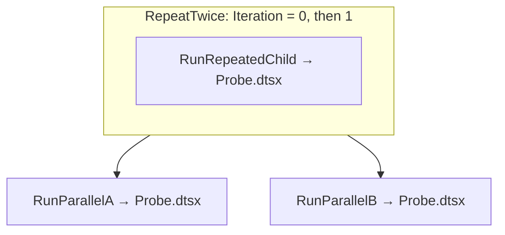

# Build the dashboard validation SSIS project

Prepared: 15 October 2026, for the local SQL Server 2022 lab. Hosting remains on hold.

Create one dedicated project with two packages. The existing sample ETL supplies useful success/failure evidence, but lacks the controlled running, repeated/parallel child, populated override, special-text and six-run history cases. A separate fixture makes these cases repeatable without changing that ETL.

The packages below use SSIS control flow and one C# Script Task. They open no database/file/network connections. Their work consists of emitting explicitly labeled fixture events, waiting for at most 60 seconds per invocation, and optionally reporting an intentional failure. Catalog execution logs are the only intended persistent output.

**Current lab status: project deployed; steps 7–10 completed and validated on 15 October 2026.** The recorded run includes six history seeds, all case types below, additive reader grants, both actual Windows reader accounts and the optional second-folder history test. [The checklist](BACKEND_CHECKLIST.md#completed-fixture-validation-15-october-2026) records 84 HTTP requests, 628 passing assertions and the remaining separate gates.

For a fresh project, build/deploy with steps 1–6, then use steps 7–10 for execution and validation. Coordinate the bounded running cases with the dashboard review.

## 1. Check the designer

Before building a fresh fixture, check the SSIS designer and VSTA components below.

1. Open Visual Studio 2022, then **Create a new project** and search for **Integration Services Project**.
2. If the template is absent, use **Extensions > Manage Extensions** to find Microsoft's **SQL Server Integration Services Projects 2022**. Install it using its installer, closing Visual Studio when requested, then reopen Visual Studio. Installing the SQL Server runtime alone does not install the package designer. Follow [Microsoft's SSIS installation guidance](https://learn.microsoft.com/en-us/sql/integration-services/install-windows/install-integration-services?view=sql-server-ver17).
3. Later, **Edit Script** must open the VSTA C# editor. If it fails or opens no editor, complete/repair the extension's VSTA component before continuing. No extra application dependency or data provider is needed for this fixture.

## 2. Create the project

1. Create an **Integration Services Project** named **`DashboardValidation`**.
2. Keep its solution/source under the repository's ignored **`.local/ssis-fixture/`** directory. For example, use `.local/ssis-fixture` as the location and let Visual Studio create its normal solution/project subdirectories. Do not replace the existing sample ETL project.
3. Right-click the project > **Properties > Configuration Properties > General**. Set **TargetServerVersion = SQL Server 2022**. Keep the **Project Deployment Model**; if a conversion option is shown, choose the project model. [SSIS project properties](https://learn.microsoft.com/en-us/sql/integration-services/integration-services-ssis-projects-and-solutions?view=sql-server-ver17).
4. Set the project **ProtectionLevel = DontSaveSensitive**. Use that same protection level on both packages. All sensitive design defaults will be empty; only a disposable test value will be supplied at execution time.
5. Rename the generated `Package.dtsx` to **`Probe.dtsx`**, accepting the package-object rename if prompted.
6. Under **SSIS Packages**, choose **New SSIS Package** and rename the new blank package to **`Parent.dtsx`**. Create it as a new package so it has its own package ID.
7. Select each package in Solution Explorer and check **EntryPoint = True** in its properties. Both packages must support direct catalog execution.
8. Leave **Connection Managers** empty. In `Project.params`, optionally add `FixtureVersion`, type **String**, value `v1`, Sensitive **False**, Required **False**. This supplies a project-scoped value alongside the package-scoped values below.

## 3. Add the Probe package parameters

Open `Probe.dtsx` and choose its **Parameters** tab. Add these names exactly, including capitalization. Set **Required = False** for every parameter.

| Name | Data type | Design default | Sensitive |
| --- | --- | --- | --- |
| `DelaySeconds` | Int32 | `2` | False |
| `Quantity` | Int32 | `7` | False |
| `Enabled` | Boolean | `True` | False |
| `TextValue` | String | `Grüße 東京's <b>fixture</b> & "quote"` | False |
| `SensitiveValue` | String | Empty string | **True** |
| `FailOnPurpose` | Boolean | `False` | False |
| `EmitCategoryMessages` | Boolean | `True` | False |
| `InvocationLabel` | String | `standalone` | False |

`Quantity` and `Enabled` are observable values only; they do not control any business operation. The script never reads `SensitiveValue`. Marking that parameter sensitive allows us to verify its flag and catalog masking with a nonempty dummy execution value. SSIS documents sensitive catalog values as NULL when queried, rather than readable plaintext. [Package/project parameter behavior](https://learn.microsoft.com/en-us/sql/integration-services/integration-services-ssis-package-and-project-parameters?view=sql-server-ver17).

## 4. Build the Probe Script Task

1. Switch to **Control Flow** and drag one **Script Task** from the SSIS Toolbox onto the canvas. Use Script Task, rather than the data-flow Script Component.
2. Rename it **`ProbeWork`** and set its **Description** to `Fixture description before override`.
3. Double-click it. Set **ScriptLanguage = Microsoft Visual C#**, **EntryPoint = Main**, and leave **ReadWriteVariables** empty.
4. In **ReadOnlyVariables**, select these seven package parameters through the `...` picker. The resulting list is:

   ```text
   $Package::DelaySeconds,$Package::Quantity,$Package::Enabled,$Package::TextValue,$Package::FailOnPurpose,$Package::EmitCategoryMessages,$Package::InvocationLabel
   ```

5. Click **Edit Script**. In the generated `ScriptMain` class, replace only its existing **`public void Main()` method** with the entire method below. Keep the generated namespace, class, attributes, references and `ScriptResults` enum. Fully qualified framework names avoid extra `using` edits.

```csharp
public void Main()
{
    int delay = (int)Dts.Variables["$Package::DelaySeconds"].Value;
    int quantity = (int)Dts.Variables["$Package::Quantity"].Value;
    bool enabled = (bool)Dts.Variables["$Package::Enabled"].Value;
    string text = (string)Dts.Variables["$Package::TextValue"].Value;
    bool fail = (bool)Dts.Variables["$Package::FailOnPurpose"].Value;
    bool categories = (bool)Dts.Variables["$Package::EmitCategoryMessages"].Value;
    string label = (string)Dts.Variables["$Package::InvocationLabel"].Value;

    if (delay < 0 || delay > 60)
    {
        Dts.Events.FireError(51001, "DashboardFixture",
            "[fixture] DelaySeconds must be between 0 and 60.", "", 0);
        Dts.TaskResult = (int)ScriptResults.Failure;
        return;
    }

    bool fireAgain = true;
    Dts.Events.FireInformation(51002, "DashboardFixture",
        System.String.Format(System.Globalization.CultureInfo.InvariantCulture,
            "[fixture] begin label={0}; Quantity={1}; Enabled={2}; TextValue={3}",
            label, quantity, enabled, text), "", 0, ref fireAgain);

    if (categories)
    {
        Dts.Events.FireWarning(51003, "DashboardFixture",
            "[fixture] duplicate classification sample; no data was processed.", "", 0);
        Dts.Events.FireInformation(51004, "DashboardFixture",
            "[fixture] memory allocation classification sample; no pressure was induced.",
            "", 0, ref fireAgain);
    }

    var timer = System.Diagnostics.Stopwatch.StartNew();
    while (timer.ElapsedMilliseconds < delay * 1000L)
    {
        if (Dts.Events.FireQueryCancel())
        {
            Dts.TaskResult = (int)ScriptResults.Failure;
            return;
        }
        System.Threading.Thread.Sleep(100);
    }

    if (fail)
    {
        Dts.Events.FireError(51005, "DashboardFixture",
            "[fixture] Intentional failure requested by FailOnPurpose.", "", 0);
        Dts.TaskResult = (int)ScriptResults.Failure;
        return;
    }

    Dts.Events.FireInformation(51006, "DashboardFixture",
        "[fixture] end label=" + label, "", 0, ref fireAgain);
    Dts.TaskResult = (int)ScriptResults.Success;
}
```

6. Build the script inside VSTA and resolve any compilation errors before closing it. Save, close VSTA, then click **OK** in the Script Task Editor to persist the compiled script into the package. Leave `ProbeWork` and package logging at the inherited/default setting; the catalog runs will select Verbose logging.
7. Save `Probe.dtsx`. For an optional designer smoke check, execute just this package: it should wait about two seconds, emit fixture information and one warning, then succeed. These designer runs do **not** seed SSISDB history.

A prepared local copy of the method is `.local/backend-validation/fixture-tools/ProbeMain.cs.txt`. It contains just the replacement method, not a complete VSTA project.

The category messages deliberately match the dashboard's existing `duplicate` warning and `memory allocation` information filters. They prove rendering/classification with populated rows; they do not simulate real low-memory or duplicate-data conditions. Script Task event calls are described in [Microsoft's event guide](https://learn.microsoft.com/en-us/sql/integration-services/extending-packages-scripting/task/raising-events-in-the-script-task?view=sql-server-ver17).

## 5. Build the Parent control flow

The parent calls `Probe.dtsx` four times: twice through the same task in a loop, then twice concurrently through separate tasks. This deliberately exercises matching repeated calls to the same child package as well as overlapping calls.



1. Open `Parent.dtsx`. Click the empty canvas, press **F4**, and set package **MaxConcurrentExecutables = 2**. Keep package errors enabled; do not force task/package success.
2. Add these **package parameters**, all Sensitive **False**, Required **False**:

   | Name | Data type | Default |
   | --- | --- | --- |
   | `SequentialDelaySeconds` | Int32 | `1` |
   | `ParallelDelaySeconds` | Int32 | `2` |
   | `EmitCategoryMessages` | Boolean | `False` |

3. With the empty package canvas selected, open **SSIS > Variables** (or the Variables window). Create these variables at **Parent package scope**, not inside a task/container. Leave EvaluateAsExpression **False**:

   | Name | Namespace | Type | Initial value |
   | --- | --- | --- | --- |
   | `Iteration` | User | Int32 | `0` |
   | `SequentialTag` | User | String | `repeat` |
   | `ParallelATag` | User | String | `parallel-A` |
   | `ParallelBTag` | User | String | `parallel-B` |

4. Drag a **For Loop Container** onto the canvas, name it **`RepeatTwice`**, and set:

   ```text
   InitExpression:   @[User::Iteration] = 0
   EvalExpression:   @[User::Iteration] < 2
   AssignExpression: @[User::Iteration] = @[User::Iteration] + 1
   ```

5. Drag an **Execute Package Task inside that container** and name it **`RunRepeatedChild`**. In its editor's **Package** page, choose **ReferenceType = Project Reference** and **PackageNameFromProjectReference = Probe.dtsx**. No connection manager is needed.
6. On **Parameter Bindings**, add these bindings. The left column is a child `Probe` parameter; the right column is the parent parameter/variable selected from the picker:

   | Child parameter | Parent source |
   | --- | --- |
   | `DelaySeconds` | `$Package::SequentialDelaySeconds` |
   | `Quantity` | `User::Iteration` |
   | `InvocationLabel` | `User::SequentialTag` |
   | `EmitCategoryMessages` | `$Package::EmitCategoryMessages` |

7. Outside the loop, create two more **Execute Package Tasks** named **`RunParallelA`** and **`RunParallelB`**. Each uses the same Project Reference to `Probe.dtsx`. For both, bind `DelaySeconds` to `$Package::ParallelDelaySeconds` and `EmitCategoryMessages` to `$Package::EmitCategoryMessages`. Bind `InvocationLabel` to `User::ParallelATag` on A and `User::ParallelBTag` on B. Other child parameters retain their defaults.
8. Draw a green **Success** precedence constraint from `RepeatTwice` to A, then a second green constraint from `RepeatTwice` to B. There is **no constraint between A and B**. Confirm each has only the one incoming loop constraint.
9. Save. Optionally execute `Parent.dtsx` in the designer: expect four child begin/end pairs, `repeat` quantities 0 and 1, followed by overlapping `parallel-A` and `parallel-B`. Default work takes roughly four seconds plus runtime overhead. It should succeed without intentional warning messages from the child.

Microsoft documents these [For Loop expressions](https://learn.microsoft.com/en-us/sql/integration-services/control-flow/for-loop-container?view=sql-server-ver17) and [project-reference parameter bindings](https://learn.microsoft.com/en-us/sql/integration-services/control-flow/execute-package-task?view=sql-server-ver17). In catalog execution, child activity belongs to the parent execution; four child calls need not produce four separate `catalog.executions` rows. Compare event/execution paths and begin/end occurrences when checking the dashboard's child matching.

## 6. Build and deploy to SSISDB

1. **Build > Build Solution**. Resolve build errors. Keep the generated `DashboardValidation.ispac` under `.local/ssis-fixture/`; the build output is normally in the project's `bin/Development/` directory.
2. In SSMS, connect to the local Database Engine with the existing **Windows-authenticated administrator**, not either dashboard reader.
3. Expand **Integration Services Catalogs > SSISDB**. Right-click SSISDB > **Create Folder**, and use this exact folder name:

   ```text
   DashboardValidation 東京's Lab
   ```

   Its Unicode, spaces and apostrophe supply a controlled name-binding case. This is a catalog folder name, not a Windows path. If the installed tooling rejects it, record the actual error and use `DashboardValidation` temporarily; retain the special-name check as open until a supported test name is deployed.

4. Right-click that folder's **Projects > Deploy Project**. Select the newly built `.ispac`, the local server, and that new folder. Review the destination before choosing **Deploy**.
5. Refresh Projects. Expect **DashboardValidation > Packages > Probe.dtsx and Parent.dtsx**. Do not deploy into or overwrite the existing sample ETL project.
6. Record the actual `.ispac` path and catalog folder/project names locally. At this point you can return to the assistant for the remaining execution/grant/validation work. No new SQL database, Agent job, SSIS environment, connection manager or reader identity is needed.

The new folder needs explicit navigation grants; the existing operation grant still refers to the old sample execution. **Do not rerun `setup-readers.sql`**: it intentionally refuses to recreate existing database users. Step 9 adds only the new fixture grants.

## 7. Seed six successful catalog executions

This step can be handled by the assistant after deployment. To do it yourself, run the following in SSMS as the Windows administrator. Use the actual folder name if you changed it. The doubled apostrophe in the SQL literal represents the single apostrophe in the folder name.

The script starts only the newly named `Probe.dtsx`. It runs six times sequentially and stops on the first unexpected outcome. Each run selects Verbose logging and no category warnings; delays vary from two to seven seconds so averaging different windows can be distinguished. These catalog executions, rather than designer executions, provide duration history. The later successful values run supplies a seventh observation for checking which earlier row drops out of the moving window.

```sql
USE [SSISDB];
SET NOCOUNT ON;
DECLARE @Folder nvarchar(128) = N'DashboardValidation 東京''s Lab';
DECLARE @Project nvarchar(128) = N'DashboardValidation';
DECLARE @Run int = 1, @ExecutionId bigint;
DECLARE @Verbose int = 3, @Delay int = 2;
DECLARE @Wait bit = 1, @NoCategories bit = 0;
DECLARE @Completed TABLE (run_number int, execution_id bigint, status int);

IF NOT EXISTS (SELECT 1 FROM catalog.projects p
    JOIN catalog.folders f ON p.folder_id = f.folder_id
    WHERE f.name = @Folder AND p.name = @Project)
    THROW 51000, 'Deploy the dedicated fixture project first.', 1;

WHILE @Run <= 6
BEGIN
    SET @Delay = @Run + 1;
    EXEC catalog.create_execution @folder_name = @Folder,
        @project_name = @Project, @package_name = N'Probe.dtsx',
        @use32bitruntime = 0, @runinscaleout = 0,
        @execution_id = @ExecutionId OUTPUT;
    EXEC catalog.set_execution_parameter_value @ExecutionId, 50,
        N'LOGGING_LEVEL', @Verbose;
    EXEC catalog.set_execution_parameter_value @ExecutionId, 50,
        N'SYNCHRONIZED', @Wait;
    EXEC catalog.set_execution_parameter_value @ExecutionId, 30,
        N'DelaySeconds', @Delay;
    EXEC catalog.set_execution_parameter_value @ExecutionId, 30,
        N'EmitCategoryMessages', @NoCategories;
    EXEC catalog.start_execution @ExecutionId;
    IF NOT EXISTS (SELECT 1 FROM catalog.executions
        WHERE execution_id = @ExecutionId AND status = 7)
        THROW 51000, 'A fixture history execution did not succeed; inspect its report.', 1;
    INSERT @Completed SELECT @Run, @ExecutionId, status
        FROM catalog.executions WHERE execution_id = @ExecutionId;
    SET @Run += 1;
END;
SELECT * FROM @Completed ORDER BY run_number;
```

Expect six rows with status **7**. Keep their IDs in ignored local evidence. Microsoft documents [creating an execution](https://learn.microsoft.com/en-us/sql/integration-services/system-stored-procedures/catalog-create-execution-ssisdb-database?view=sql-server-ver17) and [execution parameter/logging settings](https://learn.microsoft.com/en-us/sql/integration-services/system-stored-procedures/catalog-set-execution-parameter-value-ssisdb-database?view=sql-server-ver17). Object type 30 selects a package parameter; 50 selects execution settings; Verbose is level 3. Settings must be applied before starting.

The reusable SQL example is `.local/backend-validation/fixture-tools/seed-history.sql`. Step 7 was completed through equivalent bound catalog calls in the local fixture helper; all six seeded executions succeeded.

## 8. Prepare the remaining execution cases

The assistant can coordinate these runs with the dashboard checks after deployment. If running manually, expand the new project's Packages, right-click the indicated package > **Execute**. Select literal values on **Parameters**; set **Advanced > Logging level = Verbose** for every run. In SSMS's value editor, explicitly set the named overrides even if another parameter retains its default. Each Execute dialog is a separate execution; restore the table's intended settings for that run.

| Case | Package and values | Expected evidence |
| --- | --- | --- |
| Values and category messages | `Probe.dtsx`: DelaySeconds `2`, Quantity `42`, Enabled `False`, TextValue `Grüße 東京's <b>fixture</b> & "quote"`, EmitCategoryMessages `True`, FailOnPurpose `False`, InvocationLabel `values`. Set SensitiveValue to a **unique disposable dummy string**, not a real password. Also add the Description override below. | Success; numeric/Boolean/string parameter rows and explicit override flags; a sensitive row whose value is NULL/masked; populated property override; warning containing `duplicate`; information containing `memory allocation`; special text shown literally. |
| Controlled failure | `Probe.dtsx`: DelaySeconds `2`, FailOnPurpose `True`, EmitCategoryMessages `False`, InvocationLabel `intentional-failure`. | Status **4**, the explicitly labeled intentional error and a completed end time. This failed run is expected. |
| Completed children | `Parent.dtsx`: SequentialDelaySeconds `1`, ParallelDelaySeconds `2`, EmitCategoryMessages `False`. | Success; four logical child invocations: two repeated and two overlapping, with completed event pairs. |
| Running root | `Probe.dtsx`: DelaySeconds `60`, FailOnPurpose `False`, EmitCategoryMessages `False`, InvocationLabel `running-root`. Start during the dashboard review. | While active: status **2**, NULL end time, nonzero elapsed time, history available for the same package. After about 60 seconds plus overhead: success. |
| Running children | `Parent.dtsx`: SequentialDelaySeconds `1`, ParallelDelaySeconds `60`, EmitCategoryMessages `False`. Start during the child review. | Two short repeated calls finish, then both parallel calls remain active for about a minute. Check incomplete child/event matching before their end events arrive, then refresh after completion. |

For the **property override** on the values run:

1. In the Probe designer, select `ProbeWork` and copy its actual **Package Path** from its properties. With these names the expected task path is `\Package\ProbeWork`; use the actual path if it differs.
2. In the catalog Execute dialog, open **Advanced > Property overrides** and add that task's **Description** property. Its expected full property path is **`\Package\ProbeWork.Properties[Description]`**.
3. Use value **`[fixture] overridden description 東京's`**, sensitive **False**. Override Description only; keep the task name, script and result properties intact.
4. Check the resulting execution's `catalog.execution_property_override_values` row. If the property path is rejected, correct the actual path instead of skipping the override or changing other properties. Microsoft describes [property paths and the matching catalog procedure](https://learn.microsoft.com/en-us/sql/integration-services/system-stored-procedures/catalog-set-execution-property-override-value?view=sql-server-ver17).

Check that the dummy sensitive string is absent from dashboard HTML, event output and application logs. Its parameter name/flag can remain visible. Do not paste the string into chat or tracked evidence; keep it only in local test inputs. SSIS's catalog masking and the application's response/log behavior are separate assertions.

An optional **history-scope** case needs no extra package authoring: deploy the same `.ispac` to a second catalog folder, `DashboardValidationOther`, and execute Probe once with DelaySeconds `4`. Comparing this run with the main folder's history tests exact-folder versus all-folder selection. Skip this additional deployment until that specific check is scheduled.

## 9. Add fixture grants to the existing readers

Run this **after at least two successful Probe catalog runs**, through the Windows-authenticated administrator. The assistant can do it as part of the next validation task. This adds the new folder/project and one new operation; it preserves the previous sample-project grants. The limited reader may therefore still see its previously granted sample execution. The visibility assertion here concerns the two **new fixture IDs**, not the limited reader's total lifetime count.

```sql
USE [SSISDB];
SET NOCOUNT ON;
SET XACT_ABORT ON;
DECLARE @Folder nvarchar(128) = N'DashboardValidation 東京''s Lab';
DECLARE @Project nvarchar(128) = N'DashboardValidation';
DECLARE @Reader int = DATABASE_PRINCIPAL_ID(N'dashboard_reader');
DECLARE @Limited int = DATABASE_PRINCIPAL_ID(N'dashboard_limited');
DECLARE @FolderId bigint = (SELECT folder_id FROM catalog.folders WHERE name = @Folder);
DECLARE @ProjectId bigint = (SELECT project_id FROM catalog.projects
    WHERE folder_id = @FolderId AND name = @Project);
DECLARE @Visible bigint = (SELECT MAX(execution_id) FROM catalog.executions
    WHERE folder_name = @Folder AND project_name = @Project
      AND package_name = N'Probe.dtsx' AND status = 7);
DECLARE @Hidden bigint = (SELECT MAX(execution_id) FROM catalog.executions
    WHERE folder_name = @Folder AND project_name = @Project
      AND package_name = N'Probe.dtsx' AND status = 7 AND execution_id < @Visible);

IF @Reader IS NULL OR @Limited IS NULL OR @Reader = @Limited
    THROW 51000, 'Review the existing reader mappings first.', 1;
IF @FolderId IS NULL OR @ProjectId IS NULL OR @Visible IS NULL OR @Hidden IS NULL
    THROW 51000, 'Deploy the fixture and finish two successful Probe runs first.', 1;
IF COALESCE(IS_ROLEMEMBER(N'ssis_logreader', N'dashboard_reader'), -1) <> 1
    OR COALESCE(IS_ROLEMEMBER(N'ssis_logreader', N'dashboard_limited'), -1) <> 0
    THROW 51000, 'Review the normal/restricted reader roles first.', 1;
IF EXISTS (SELECT 1 FROM sys.dm_exec_connections
    WHERE session_id = @@SPID AND auth_scheme = N'SQL')
    THROW 51000, 'Use the Windows-authenticated administrator for catalog grants.', 1;

BEGIN TRANSACTION;
DECLARE @Result int;
EXEC @Result = catalog.grant_permission 1, @FolderId, @Reader, 1;
IF @Result <> 0 THROW 51000, 'Normal reader folder grant failed.', 1;
EXEC @Result = catalog.grant_permission 1, @FolderId, @Limited, 1;
IF @Result <> 0 THROW 51000, 'Restricted reader folder grant failed.', 1;
EXEC @Result = catalog.grant_permission 2, @ProjectId, @Limited, 1;
IF @Result <> 0 THROW 51000, 'Restricted reader project grant failed.', 1;
EXEC @Result = catalog.grant_permission 4, @Visible, @Limited, 1;
IF @Result <> 0 THROW 51000, 'Restricted reader operation grant failed.', 1;
COMMIT TRANSACTION;
SELECT @Visible AS visible_fixture_execution_id,
       @Hidden AS must_be_hidden_fixture_execution_id;
```

These are catalog READ grants (permission 1), with object types folder 1, project 2 and operation 4. No EXECUTE or administrator permission is added. Repeating this script later can deliberately grant a different newest execution; retain the original returned pair for an ongoing validation run. [Catalog grant procedure](https://learn.microsoft.com/en-us/sql/integration-services/system-stored-procedures/catalog-grant-permission-ssisdb-database?view=sql-server-ver17).

The reusable SQL example is `.local/backend-validation/fixture-tools/add-fixture-reader-grants.sql`. Step 9 was completed through equivalent bound calls, retaining the selected visible/hidden pair privately.

Under the normal reader, both fixture IDs must be visible. Under the limited reader, only the chosen visible ID should be present. An unexpected second visible fixture ID must be investigated for old grants, execution ownership or inherited roles before calling isolation a pass. Full-permission page checks use the normal reader; hidden-row/HTTP checks use the limited reader. There is no need to give the limited reader all the new executions.

## 10. Hand off for local validation

The user deployed the project; the assistant inspected/exported its actual catalog `.ispac` and completed steps 7–9. Both actual Windows reader accounts then completed native SQL and HTTP replay through the secure local helper. All four steps are recorded as PASS in the private run summary.

Actual identity checks now pass: each reader process completed 15 HTTP requests with the intended non-admin roles. For repeats, use the local `tools/run-reader-validation.ps1` helper or launch SSMS/Python with **Run as different user**. Passwords stay in the local secure prompt; a browser profile does not change SQL identity. See [the reader reference below](#reader-permissions-and-sign-in-reference) for configuration.

The project enables the remaining representative portions of DB-03 and UI-02/03/04/05/06, plus repeatable identity tests DB-01/02 and HTTP-02 when combined with the readers. Native cleanup-failure observation and API workload follow-ups remain separate; C1b resolved typed datetimeoffset conversion. HOST-01/02/03 and production hosting/logging remain NOT RUN/on hold.

## Reader permissions and sign-in reference

The two Windows accounts and initial catalog mappings already exist. Their setup instructions and full original grant script are retained with the private preparation record; do not recreate the users or rerun the initial setup for this project. Use step 9's additive grants after deployment.

| Identity | Server / SSISDB rights | Intended visibility |
| --- | --- | --- |
| `dashboard_reader` | Default server `public`; mapped SSISDB user and CONNECT; `ssis_logreader`; catalog READ on the fixture folder | Catalog-wide operational logs in this isolated lab, with folder navigation |
| `dashboard_limited` | Default server `public`; mapped SSISDB user and CONNECT; catalog READ on selected folder/project and one operation; no `ssis_logreader` | Selected visible fixture execution; the comparison execution stays hidden |

Neither reader needs sysadmin/securityadmin, db_owner/ssis_admin/db_datareader, package execution/modification, business-database access, SQL Agent roles or server-wide DMV access. Use the existing Windows administrator for deployment, runs, grants and plans. `ssis_logreader` is catalog-wide, not a per-folder isolation boundary; explicit operation grants serve the restricted-reader test. [SSISDB roles](https://learn.microsoft.com/en-us/sql/integration-services/security/integration-services-roles-ssis-service?view=sql-server-ver16).

For a fresh lab, create standard Windows accounts before `CREATE LOGIN ... FROM WINDOWS`; a SQL login maps an existing Windows identity. Error 15401 means that Windows identity could not be resolved. The local `tools/create-reader-windows-users.ps1` helper prompts for passwords securely in elevated 64-bit PowerShell; `tools/setup-readers.sql` is the original one-time mapping/grant draft with four input placeholders. These are local helpers, not scripts to rerun on this already configured lab. Windows-backed logins work with the current Windows-only SQL authentication mode; no mode change/restart is required. SQL-authenticated readers would require mixed mode and a scheduled engine/Agent restart, as described by [Microsoft](https://learn.microsoft.com/en-us/sql/database-engine/configure-windows/change-server-authentication-mode?view=sql-server-ver16).

Launch SSMS or Python as each Windows reader using **Run as different user**, then choose Windows Authentication. A browser profile does not change SQL identity. Run this in SSISDB under each actual reader session, replacing the two zeros with the privately retained visible/hidden pair:

```sql
SELECT SUSER_SNAME() AS login_name, USER_NAME() AS database_user,
       IS_SRVROLEMEMBER('sysadmin') AS is_sysadmin,
       IS_MEMBER('db_owner') AS is_db_owner,
       IS_MEMBER('ssis_admin') AS is_ssis_admin,
       IS_MEMBER('ssis_logreader') AS is_logreader;
SELECT execution_id FROM catalog.executions
WHERE execution_id IN (0, 0) ORDER BY execution_id;
```

Expect admin flags zero for both; logreader one only for the normal reader. It sees both selected IDs, while the limited reader sees only the chosen visible ID. Confirm folder/project navigation too. Keep separate private `.local/backend-validation/dashboard-reader.cfg` and `dashboard-limited.cfg`, using the working config's runtime/timeouts. With Windows authentication their identity comes from the process account; keep any SQL-auth UID/PWD only in the relevant ignored config. Keep passwords out of chat and tracked files.

Record actual reader HTTP/hidden-row results in [the consolidated checklist](BACKEND_CHECKLIST.md#reader-visibility). The initial session-impersonation audit was setup evidence; the actual-account replay has now finished these checks. Reuse the local helper when repeating them against another run.
